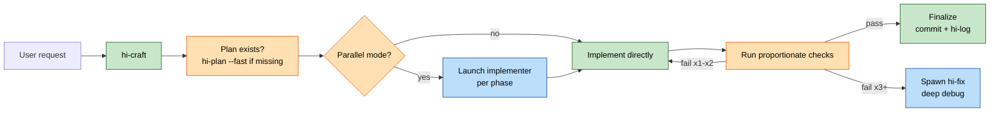
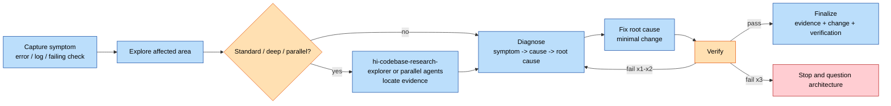
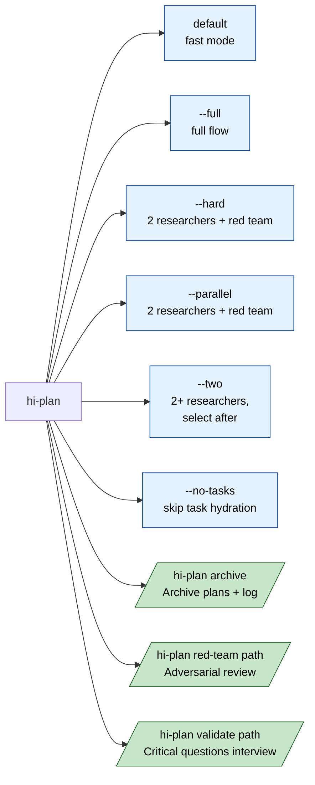
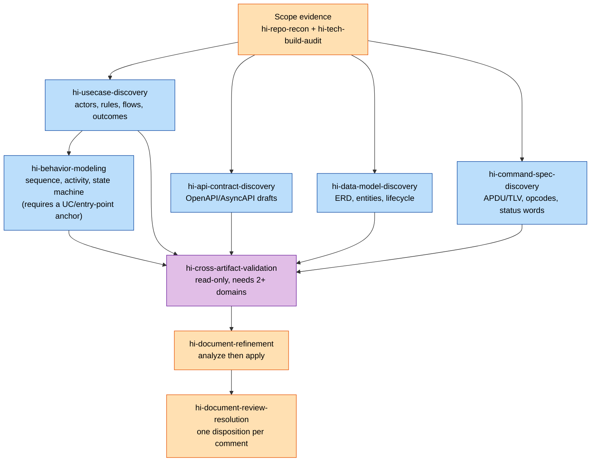
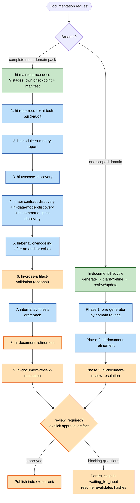
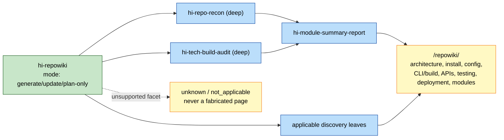
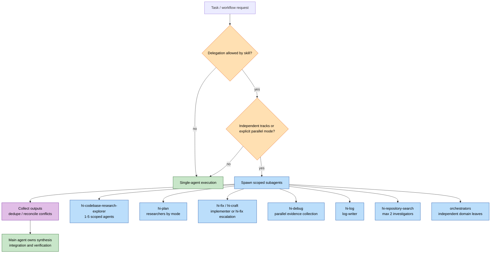

# DevKit — Workflow Diagrams

> Visual workflows for the kit: core skills (`hi-craft`, `hi-fix`, `hi-plan`), the discovery-to-documentation pipelines, and the cross-skill integration graph. Catalog and invocation syntax live in [README.md](README.md). Mode-selection rationale and delegation semantics: [dev-shared/delegation-contract.md](dev-shared/delegation-contract.md).

---

## 0. Skill Roles

### 0.1 Orchestrators

Skills that own global state, stage ordering, and publication. They are the only writers of checkpoint/manifest state.

| Skill | Owns | Calls |
| --- | --- | --- |
| `hi-maintenance-docs` | Complete multi-domain documentation pack (9 stages) | `hi-repo-recon`, `hi-tech-build-audit`, `hi-module-summary-report`, `hi-usecase-discovery`, `hi-api-contract-discovery`, `hi-data-model-discovery`, `hi-command-spec-discovery`, `hi-behavior-modeling`, `hi-cross-artifact-validation`, `hi-document-refinement`, `hi-document-review-resolution` |
| `hi-document-lifecycle` | One scoped domain, generate → clarify/refine → review/update with pause/resume | exactly one generator (`hi-module-summary-report`, `hi-usecase-discovery`, `hi-behavior-modeling`, `hi-api-contract-discovery`, `hi-data-model-discovery`, `hi-command-spec-discovery`) plus `hi-document-refinement` and `hi-document-review-resolution` |
| `hi-repowiki` | Repository wiki in `/repowiki/` (generate, update, plan-only) | `hi-repo-recon`, `hi-tech-build-audit`, `hi-module-summary-report`, applicable discovery leaves |

### 0.2 Core workflow skills

| Skill | Role |
| --- | --- |
| `hi-plan` | Implementation plans, architecture roadmaps, phased plans, plan validation |
| `hi-craft` | Feature implementation: plan → implement → test → finalize |
| `hi-fix` | Issue resolution across bugs, tests, CI, types, lint, UI, runtime |
| `hi-debug` | Root-cause debugging of failures, logs, CI, databases, performance |

### 0.3 Leaf skills (called by main skills)

| Skill | Called by | Purpose |
| --- | --- | --- |
| `hi-codebase-research-explorer` | fix, debug, ad-hoc | Parallel file discovery and external research |
| `hi-repository-search` | plan, debug, ad-hoc evidence queries | Traceable repository evidence bundle |
| `hi-knows` | ad-hoc (no skill declares it as a leaf) | Knowledge retrieval from git, MCP, memory files |
| `hi-docs-seeker` | plan, debug, craft (full) | Authoritative external documentation lookup |
| `hi-log` | craft, plan, finalization flows | Session logging |
| `hi-sequential-thinking` | plan, ad-hoc reasoning requests | Step-by-step reasoning with revision |
| `hi-problem-solving` | fix, debug | Stuck-point techniques |
| `hi-project-organization` | any file-producing workflow | Output paths, names, layout |
| `hi-repo-recon` | maintenance-docs, repowiki, use-case discovery | Module inventory, entry points, key functions |
| `hi-tech-build-audit` | maintenance-docs, repowiki | Stack, build, CI/CD, deployment audit. `hi-module-summary-report` consumes its artifacts but must not invoke it. |
| `hi-module-summary-report` | maintenance-docs, repowiki, document-lifecycle | Architecture summary + risk synthesis |
| `hi-usecase-discovery`, `hi-behavior-modeling`, `hi-api-contract-discovery`, `hi-data-model-discovery`, `hi-command-spec-discovery` | maintenance-docs, document-lifecycle | Draft-only discovery artifacts |
| `hi-cross-artifact-validation` | maintenance-docs | Read-only cross-domain consistency validation |
| `hi-document-refinement`, `hi-document-review-resolution` | maintenance-docs, document-lifecycle | Semantic refinement and review-comment resolution |

### 0.4 Analysis and review skills

| Skill | Trigger |
| --- | --- |
| `hi-scenario` | Edge cases and test scenarios across 12 dimensions |
| `hi-brainstorm` | Ambiguous or consequential decisions: competing options, weighted scoring |
| `hi-predict` | Pre-analysis with GO/CAUTION/STOP verdict before risky changes |
| `hi-security` | STRIDE + OWASP audit, optional iterative auto-fix |

### 0.5 Standalone tool and integration skills

| Skill | Type | Purpose |
| --- | --- | --- |
| `hi-repository-search` | Code + doc exploration | Search ingested repos via code graph (Qdrant/Neo4j/FalkorDb) + document graph RAG. Semantic search, call-graph tracing, dependency analysis. |
| `hi-cortex` | Harness infrastructure | Install and operate Cortex Harness: config, code/doc sync, database infrastructure, MCP lifecycle for use by other skills. |
| `hi-chrome-devtools` | Browser automation | Browser automation via Puppeteer CLI with persistent sessions. Screenshots, performance, network, scraping, form automation, auth, debugging. |
| `slide-kit` | Deliverable generation | `.pptx` decks in the Modernization corporate style, brand-neutral. No skill calls it; it answers direct deck requests. |
| `typesafe-ai` | AI feature building | TypeSafe System One models (Jev): typed judgments (Choice/Score/Noul) as programming primitives. The optional judgment backend behind [dev-shared/jev-contract.md](dev-shared/jev-contract.md). |
| `hi-reverse` | Reverse engineering | C/C++ → use-case, module, and C++-to-Java migration artifact packages; self-contained pipeline with package gates. |
| `dev-shared` | Support package | Cross-skill contracts and role briefs. Never activated directly. |

---

## 1. Core Pipelines

### 1.1 `hi-craft` — Feature Implementation

#### Mode Matrix

| Mode | Research | Plan | Review | Test | Finalize |
| --- | --- | --- | --- | --- | --- |
| `fast` (default) | skip | inline `hi-plan --fast` | skip | run | commit + log |
| `full` | yes (mode-dependent) | yes | MUST | run | commit + log + review |
| `review` | skip | inline | MUST | run | commit + log + review |
| `auto` | skip | inline | auto-pass | run | commit + log |
| `no-test` | skip | inline | skip | skip | commit + log |
| `code` (path to plan) | skip | — | optional | run | commit + log |

The plan gate applies in every mode: a plan is required unless the user explicitly says "just code it" / "skip planning".

### 1.2 `hi-fix` — Issue Resolution

| Mode | Scope | Repository evidence | Delegation |
| --- | --- | --- | --- |
| default | 1 file, type/lint, or clear issue | Direct inspection | 1 agent is enough |
| `--standard` | 2-5 files | Full explorer and diagnosis | `hi-codebase-research-explorer` or `2-3` parallel agents when useful |
| `--deep` | 5+ files or architectural impact | Parallel explorer, diagnosis, research | Parallel agents for exploration/research |
| `--parallel` | 2+ independent issues | Separate task tree per issue | Spawn `implementer` per issue |
| `--review` | Any scope | Mode-dependent | Human review at gates |

### 1.3 `hi-plan` — Implementation Planning

| Mode | Research | Delegation | Review |
| --- | --- | --- | --- |
| default / `--fast` | Skip formal research; read docs or scan only if needed | None | None |
| `--full` | Research enabled | 1 researcher | Optional red-team and validation |
| `--hard` | Deep research and impact analysis | 2 researchers | Required red-team |
| `--parallel` | Parallel-track research | 2 researchers | Required red-team |
| `--two` | Competing approaches | 2+ researchers | Review after selection |

```mermaid
graph LR
    A["Scan active plans"] --> B["Gather evidence<br/>hi-repository-search"]
    B --> R{"Research mode?"}
    R -->|fast| C["Define assumptions<br/>dependencies / gaps"]
    R -->|full / hard / parallel / two| S["Spawn researcher agents<br/>by selected mode"]
    S --> C
    C --> D["Write plan.md<br/>and phase files"]
    D --> E{"3+ phases?"}
    E -->|yes| F["Hydrate tasks"]
    E -->|no| G["Skip task overhead"]
    F --> H["Return plan path<br/>and execution command"]
    G --> H

    classDef step fill:#bbdefb,stroke:#0d47a1,color:#000
    classDef evidence fill:#e1bee7,stroke:#6a1b9a,color:#000
    classDef delegated fill:#bbdefb,stroke:#0d47a1,color:#000
    classDef gate fill:#ffe0b2,stroke:#e65100,color:#000
    class A,C,D,F,G,H step
    class B evidence
    class S delegated
    class R,E gate
```

Subcommands: `/hi-plan archive` (archive plans + log), `/hi-plan red-team {path}` (adversarial review), `/hi-plan validate {path}` (critical-questions interview).

---

## 2. Discovery → Validation → Documentation

### 2.1 Discovery Artifact Pipeline

Five draft-only leaf skills produce evidence-backed artifacts for one module or scope; `hi-cross-artifact-validation` then checks consistency across them. Leaves never publish — the orchestrator owns refinement, review, and publication.

Boundaries that keep this pipeline honest:

- Each leaf is draft-only and states its own exclusion list (e.g. `hi-command-spec-discovery` is not for business scenarios or API contracts; `hi-behavior-modeling` is not for use-case catalogs).
- `hi-cross-artifact-validation` is read-only and blocks when fewer than two domain manifests exist.
- `hi-document-refinement` finds ambiguity and applies validated answers to an **isolated candidate revision**; it never self-publishes and never invents answers.
- `hi-document-review-resolution` assigns exactly one disposition per comment (`accepted`, `rejected`, `needs_information`, `duplicate`, `stale`, `out_of_scope`, `unsupported_by_evidence`). Comment resolution and publication approval are separate actions.

### 2.2 Documentation Lifecycle

Two orchestrators, one stage contract. `hi-maintenance-docs` runs the full pack; `hi-document-lifecycle` runs a single domain with the same leaf skills.

### 2.3 Repository Wiki Pipeline

`hi-repowiki` is a third orchestrator with its own entry conditions: it generates or updates a `/repowiki/` tree, supports `generate` / `update` / `plan-only` modes, `en` / `zh` output, and `--resume`.

### 2.4 `hi-reverse` — self-contained reverse-engineering pipeline

`hi-reverse` does not join the documentation pipeline; it runs its own gated sequence over C/C++ sources and emits migration-ready packages.

---

## 3. Cross-skill Integration

```mermaid
graph TD
    User(["User request"]) --> Detect{"Intent"}

    Detect -->|"feature / implementation"| Craft["hi-craft"]
    Detect -->|"bug / failure"| Fix["hi-fix"]
    Detect -->|"plan / architecture"| Plan["hi-plan"]
    Detect -->|"repo question / impact"| RepoSearch["hi-repository-search"]
    Detect -->|"debug investigation"| Debug["hi-debug"]
    Detect -->|"security audit"| Security["hi-security"]
    Detect -->|"edge cases / tests"| Scenario["hi-scenario"]
    Detect -->|"ambiguous decision"| Brainstorm["hi-brainstorm"]
    Detect -->|"risky change pre-check"| Predict["hi-predict"]
    Detect -->|"browser task"| Chrome["hi-chrome-devtools"]
    Detect -->|"documentation pack / wiki"| Docs["hi-maintenance-docs / hi-repowiki"]
    Detect -->|"C/C++ reverse engineering"| Reverse["hi-reverse"]
    Detect -->|"deck / pptx"| Slide["slide-kit"]

    Craft -->|"plan needed"| Plan
    Craft -->|"verification fails repeatedly"| Fix
    Craft -->|"final record"| Log

    Fix -->|"root cause difficult"| Debug
    Fix -->|"2+ failed hypotheses"| PS["hi-problem-solving"]
    Fix -->|"final record"| Log

    Plan -->|"code/doc evidence"| RepoSearch
    Plan -->|"complex reasoning"| ST["hi-sequential-thinking"]
    Plan -->|"docs for a library/API"| DocsSeeker["hi-docs-seeker"]
    Plan -->|"outputs / naming"| Org["hi-project-organization"]
    Plan -->|"archive / final record"| Log

    Debug -->|"find files / external research"| Explorer["hi-codebase-research-explorer"]
    Debug -->|"repo evidence"| RepoSearch
    Debug -->|"stuck"| PS

    Docs -->|"structure evidence"| Recon["hi-repo-recon"]
    Docs -->|"build evidence"| Audit["hi-tech-build-audit"]
    Docs -->|"synthesis"| Summary["hi-module-summary-report"]
    Docs -->|"draft artifacts"| Leaves["hi-usecase-discovery / hi-api-contract-discovery / hi-data-model-discovery / hi-command-spec-discovery / hi-behavior-modeling"]
    Docs -->|"cross-domain check"| XV["hi-cross-artifact-validation"]
    Docs -->|"refine / resolve comments"| DLC["hi-document-refinement / hi-document-review-resolution"]
    Docs -->|"final record"| Log

    Cortex["hi-cortex"] -->|"healthy MCPs"| RepoSearch

    classDef primary fill:#c8e6c9,stroke:#1b5e20,color:#000
    classDef evidence fill:#e1bee7,stroke:#6a1b9a,color:#000
    classDef analysis fill:#bbdefb,stroke:#0d47a1,color:#000
    classDef utility fill:#fff9c4,stroke:#f57f17,color:#000
    classDef external fill:#f5f5f5,stroke:#333,color:#000

    class Craft,Fix,Plan,Docs,Reverse primary
    class RepoSearch,Recon,Audit,Summary,Leaves,XV,DLC,Explorer,DocsSeeker evidence
    class Debug,Security,Scenario,ST,PS,Brainstorm,Predict analysis
    class Log,Org,Chrome,Cortex,Slide utility
    class User,Detect external
```

The intent table behind that graph:

| Intent | Skill | Escalates to |
| --- | --- | --- |
| Feature / implementation | `hi-craft` | `hi-plan` (no plan), `hi-fix` (3+ test failures) |
| Bug / failure | `hi-fix` | `hi-debug`, `hi-problem-solving` |
| Plan / architecture | `hi-plan` | `hi-repository-search --deep`, red-team, validate |
| Repository question / impact | `hi-repository-search` | evidence-only; the calling skill keeps orchestration |
| Debug investigation | `hi-debug` | `hi-codebase-research-explorer`, `hi-docs-seeker` |
| Security audit | `hi-security` | `mind_mcp` policy context, `graph_mcp` structure (T3) |
| Edge cases / tests | `hi-scenario` | `graph_mcp` feature paths (T3) |
| Ambiguous decision | `hi-brainstorm` | `hi-plan --two` for competing approaches |
| Risky change pre-check | `hi-predict` | verdict drives the next step: GO → `hi-plan`, CAUTION → mitigations, STOP → redesign |
| Documentation pack / wiki | `hi-maintenance-docs`, `hi-document-lifecycle`, `hi-repowiki` | discovery leaves, refinement, review resolution |
| C/C++ reverse engineering | `hi-reverse` | its own validation and package gates |
| Deck / pptx | `slide-kit` | — |
| Browser task | `hi-chrome-devtools` | — |
| Retrieval infrastructure | `hi-cortex` | `hi-repository-search` once MCPs are healthy |

---

## 4. Agent Spawning And Delegation

Most DevKit skills stay single-agent by default. Delegation happens only when the skill file explicitly allows it and the work has independent tracks, repeated failures, or a mode that asks for parallel execution. Because DevKit runs on multiple harnesses (Claude Code, ZCode, Zed, VS Code Copilot) with different delegation primitives, all worker launches follow [dev-shared/delegation-contract.md](dev-shared/delegation-contract.md):

1. **Probe once per workflow** — check the runtime for a native subagent tool, then a delegation MCP server, then fall back to inline execution. Probe the tool list, not the harness name.
2. **Roles are briefs, not agent types** — `researcher`, `implementer` (alias `fullstack-developer`), `reviewer`, `log-writer` are briefs under `dev-shared/roles/` (or skill references) pasted into whatever generic subagent the harness provides.
3. **Fallback ladder** — native spawn → MCP spawn → inline sequential passes, disclosed as `[inline:<role>]`; sequential self-analysis is never presented as parallel agents.
4. **Receipts and guards** — every delegation (or inline fallback) writes a receipt to the task primitive or log; max 5 delegated units per workflow; escalation depth 1.

| Skill | Delegates? | Trigger / condition |
| --- | --- | --- |
| `hi-codebase-research-explorer` | Yes, by design | Splits local, external, or hybrid exploration into `1-5` non-overlapping agents. Skips task registration when `<=2` agents or task tools are unavailable. Each agent has a 3-minute timeout. |
| `hi-craft` | Conditional | `--parallel` delegates one `implementer` (`fullstack-developer` alias) per phase. Test failures are handled directly for attempts 1-2; attempt 3+ invokes `hi-fix`. Planner and tester roles are never delegated. |
| `hi-fix` | Conditional | Standard/deep modes can activate `hi-codebase-research-explorer` or `2-3` parallel workers. `--parallel` creates a separate task tree and delegates `implementer` per independent issue. |
| `hi-plan` | Conditional | Delegates the `researcher` role: 1 for `--full`, 2 for `--hard` and `--parallel`, 2+ for `--two` (competing approaches). Fast/default mode never delegates. |
| `hi-debug` | Conditional | Multi-component investigations, parallel log/data collection, or CI/CD failures with 3+ possible causes may spawn parallel collection agents. |
| `hi-log` | Conditional | Delegates `log-writer` for material changes; writes inline for small sessions. If there is no material change, logging aborts. |
| `hi-repository-search` | Conditional | Does not spawn by default. Uses at most two investigators, code and documents, only when delegation is permitted and the work has independent tracks, spans 3+ subsystems, or needs independent conflict verification. |
| `hi-maintenance-docs`, `hi-document-lifecycle`, `hi-repowiki` | Conditional | Orchestrators may run independent domain leaves in parallel when their manifests do not overlap; the orchestrator keeps sole ownership of checkpoint and manifest state. |

---

## 5. HARD-GATEs

| Skill | HARD-GATE | Violation behavior |
| --- | --- | --- |
| `hi-craft` | Do not edit until a reviewed plan exists, unless the user explicitly skips planning. | Stop, create or reuse a plan, then continue. |
| `hi-fix` | Do not fix before locating the failure and identifying root cause. | Return to explore/diagnose; after 3 failed fix attempts, question architecture with the user. |
| `hi-plan` | Scan active plans first and record relevant `blockedBy` / `blocks` relationships. | Update the related plans before producing the new plan. |
| `hi-repository-search` | Provide traceable evidence only; do not invent context or own implementation decisions. | Report search coverage and ask for details if evidence is missing. |
| `hi-security` | Security findings need source evidence and severity-ranked remediation. | Do not auto-fix outside the requested audit/fix scope. |
| `hi-project-organization` | Do not override established project layout without evidence. | Use existing conventions or return an advisory recommendation. |

### Pipeline gates

Pipeline gates that behave like hard gates:

| Skill | Gate |
| --- | --- |
| `hi-cross-artifact-validation` | Blocks unless at least two domain manifests are available; never modifies source artifacts. |
| `hi-maintenance-docs` | Publication requires an explicit approval artifact; resolving every comment does not approve a document. |
| `hi-document-lifecycle` | Pauses in `waiting_for_input`; resume revalidates input, artifact, and parent hashes. Retry and clarification counters never reset. |
| `hi-reverse` | `CATALOG_GATE` before planning, `REVERSE_PACKAGE_GATE` before a package is considered complete. |

---

## 6. General Rules (Cross-cutting)

1. **Hard-gate first, fast-path later** — default to the lightweight mode, use flags for expansion.
2. **Invoke > Delegate** — invoke skills inline by default; delegate roles only on explicit triggers (3+ fails, 2+ hypothesis fails, large scope, `--parallel`, independent domain tracks). All delegation follows [dev-shared/delegation-contract.md](dev-shared/delegation-contract.md): probe once → role brief → receipt.
3. **Token budget** — each delegated role = 10-15K tokens. Prioritize inline methodology.
4. **Test/Verify just enough** — `typecheck+lint` for quick, `+build+test` for standard, `comprehensive` for deep, per [dev-shared/test-budget.md](dev-shared/test-budget.md).
5. **Review optional** — run only via `--review` or `full` mode. Auto-approve requires score ≥ 9.5 + 0 critical.
6. **Finalize = commit + log** — always conclude with a git commit + `/hi-log` (decisions, root causes, impacts).
7. **Discovery artifacts are draft-only** — leaves produce evidence-backed drafts; refinement works on isolated candidates; publication needs explicit human approval from the orchestrator.
8. **Jev optional** — typed judgment calls (routing, triage, scoring) may use `dev-shared/jev/jev_ask.py` per [dev-shared/jev-contract.md](dev-shared/jev-contract.md). On probe failure or low confidence, fall through to the existing heuristic — behavior is identical with or without Jev.
