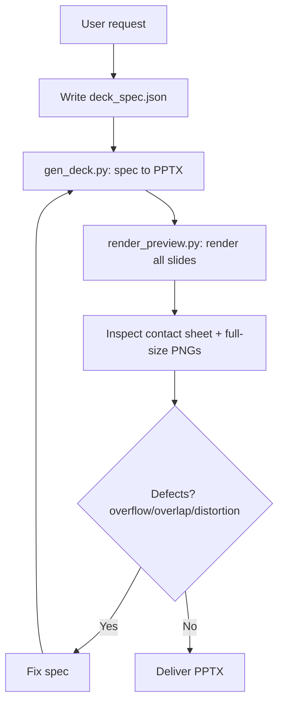
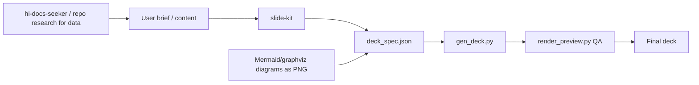

# Slide Kit Skill: Complete Guide

> `slide-kit` is a Python-based deck generator that turns a JSON spec into a `.pptx` file in the fixed Modernization (Template3) corporate style, then renders every slide for mandatory visual QA before delivery.

## 1. Objective

The skill produces `.pptx` decks that match the style extracted from `Template3.pptx` (the "Modernization Strategy" deck):

- cover/section/closing slides on a real navy constellation artwork (1920×1080) with white Lato Bold 50pt titles;
- white content slides with a 12pt eyebrow, 32pt slate `#445469` Lato title, 3 accent squares and a bottom-right page number;
- light-blue `#C9EAF7` info boxes, rounded slate/lime flowchart boxes with arrows, horizontal timelines;
- zebra tables with a blue `#1986AF` header, dark slate code panels, red bold-italic footnotes.

The kit is **strictly brand-neutral**: slides carry no logo at all — never insert any company logo or brand asset.

Use it whenever the user asks for slides/deck/pptx "in this style", "like Template3/Modernization", or loads the kit explicitly.

## 2. Hard outcomes

- The deck matches the fixed style tokens (they are hardcoded in `gen_deck.py`, not re-derived per run).
- Every slide is rendered with a real PowerPoint engine and visually inspected before completion.
- Text density stays sane: max ~6 bullets per slide, tables ≤ 12 rows, one idea per slide.
- Slide language follows the user's language (the reference deck is Vietnamese with full diacritics — Lato renders them fine).

## 3. Overall workflow



## 4. Quick start

```bash
python3 <skill_dir>/scripts/gen_deck.py spec.json -o deck.pptx
python3 <skill_dir>/scripts/gen_deck.py <skill_dir>/examples/deck_spec.json -o /tmp/example_deck.pptx
```

Mandatory QA before delivery:

```bash
python3 <skill_dir>/scripts/render_preview.py deck.pptx --output-dir /tmp/deck_preview
```

Open `contact-sheet.jpg` and every `slide-NN.png`; check for text overflow/overlap, overlong tables, misaligned nodes/connectors, wrapped timeline labels, distorted images. Fix the spec → regenerate → re-render until clean. Never claim completion before rendering and inspecting every slide.

## 5. Spec format (JSON)

Top level:

```jsonc
{
  "output": "deck.pptx",
  "eyebrow": "Modernization Strategy",
  "slides": [
    { "layout": "cover",   "title": "...", "subtitle": "...(optional)", "title_y": 182.9, "size": 50 },
    { "layout": "section", "title": "..." },
    { "layout": "content", "title": "...", "body": [ /* blocks */ ],
      "note": "footnote", "note_size": 14, "note_color": "FF0000" },
    { "layout": "thanks",  "title": "THANK YOU!" }
  ]
}
```

- Four layouts: `cover`, `section` (divider, cover-like, no page number), `content`, `thanks`. The old `agenda` layout was removed (the template has none).
- Root-level `eyebrow` applies to every content slide and can be overridden per slide.
- `note` is a red `#FF0000` bold-italic footnote (default 14pt).
- Every slide accepts `"notes": "speaker notes"`.

### Body blocks

The body is an array of blocks stacked vertically inside 46.7→919pt / y 88→500pt; `"h"` sets the block height in pt (omit to auto-measure):

| type | key parameters |
|---|---|
| `bullets` | `items`: [{"t", "lvl" 0/1/2, "bold"}] — 18/16/14pt, `•` bullets, marL 22.5/58.5/94.5pt |
| `heading` | `text`, `size` (18 default) |
| `infobox` | `cols`: [[{"title", "text"} or {"paras": [...]}], [...]] — `#C9EAF7` boxes, 12pt; `row_gap` 23.3, `col_gap` 51.5 |
| `flow` | `nodes`: [{"id", "x", "y", "w" 114, "h" 61.7, "tone" "slate"/"lime"/"outline", "text", "sub", "size" 16}], `edges`: [{"from", "to", "type" "elbow"/"straight", "from_side"/"to_side", "points", "dash", "arrow"}] |
| `timeline` | `stages`: [...] — line x=91→858, dots `#45546B`, bold 18pt labels; `y`, `x0`, `x1`, `label_size` |
| `table` | `header` [], `rows` [[...]], `cols` [ratios], `align`, `size` (auto 11→8), `"^"` cell = vertical merge |
| `image` | `path`, fit-centered; `caption` 14pt italic; `callouts`: [{"text", "xy", "point"}] — label + dashed orange leader line |
| `columns` | `cols`: [block...], `weights`, `gap` |
| `code` | `panels`: [{`title`, `code`}], slate `#46546C` background, `size` 8, JSON/SQL-ish highlighting |
| `cards` | `groups` + `legend` — lime/blue/peach tinted chips from the theme palette |

### Inline markup (usable in all text)

- `**bold**`
- `[[red|red text]]` — colors: `red` `#D53E23`, `green` `#21B14B`, `orange` `#FB8635`, `teal` `#1986AF`, `tealdark` `#0E5F7E`, `blue` `#0066B3`, `gray` `#7F7F7F`, `white`, `ink` `#445469`, `lime` `#9CB631`, `slate` `#46546C`

## 6. Style tokens

Tokens are hardcoded in `gen_deck.py`, measured directly from Template3.pptx; key values:

| Token | Value | Used for |
|---|---|---|
| Page size | 13.33 × 7.5 in (960×540pt), 16:9 | |
| Fonts | Lato Regular (page numbers "Lato"), Arial fallback | |
| Text color | `#445469` (theme dk1/dk2) | eyebrow, title, body |
| Cover/section/thanks background | `assets/bg_cover.jpg` / `bg_thanks.jpg` (1920×1080 navy constellation) | |
| Cover title | Lato Bold 50pt white, box (32.3, 182.9) 626.6×117.9pt; subtitle 14pt white (33.6, 311.7) | |
| Eyebrow / Title | 12pt (30.7, 11.8) / 32pt (30.7, 25.8) 872.3×33.5pt, 90% spacing | content slides |
| 3 squares | 8.6×7.2pt at (33.8/48.3/62.8, 63.3), `#0066B3`/`#F36F21`/`#22B24C` | content slides |
| Page number | 10pt `#7F7F7F` (931.6, 508.9) + `#A6A6A6` tick, absolute numbering, content slides only | |
| Note | 14pt bold italic `#FF0000`, box (8.9, 460) bottom-anchored | |
| Infobox / Table | `#C9EAF7` / header `#1986AF` + zebra `#C9EAF7`/`#EAF6FC` | |
| Flow / Timeline | slate `#46546C`, lime `#9CB631`, 2.2pt lines / line `#8A93A0`, dot `#45546B` | |
| Callout | dashed orange `#FB8635` 1.5pt, 18pt label | |
| Code panel | background `#46546C`, key `#E06C75`, string `#98C379`, comment `#97A3B3`, number `#D19A66` | |
| Flow box size | 114×61.7pt, 16.7% corner radius | |

## 7. Content rules

- Set `eyebrow` once at root (e.g. "Modernization Strategy" in the template).
- Content slide titles are short phrases (numbering not required).
- Density: max ~6 bullets per slide or tables ≤ 12 rows; one idea per slide. Split dense content across slides.
- Prefer infoboxes/tables plus bold/color markup over long paragraphs; use the red bottom `note` for caveats.
- Diagrams: use the `flow`/`timeline` blocks to stay on-style, or generate PNGs (≥2x) and embed via `image`/`columns`; screenshots can take dashed-orange `callouts`.
- `flow`/`callouts` coordinates are measured on the 960×540 pt canvas.

## 8. Files and environment

```
slide-kit/
├── SKILL.md                  ← source of truth for this guide
├── assets/                   ← bg_cover.jpg, bg_thanks.jpg (template backgrounds)
├── scripts/gen_deck.py       ← spec JSON → .pptx (python-pptx)
├── scripts/render_preview.py ← .pptx → per-slide PNGs + contact sheet (PowerPoint AppleScript, soffice fallback)
└── examples/deck_spec.json   ← sample deck covering every layout/block (with example_diagram.png)
```

Environment: Python 3 + `python-pptx`, `pillow`; macOS + Microsoft PowerPoint for render QA (or LibreOffice). The machine needs the **Lato** font for exact typography.

## 9. Extending

- New layouts/blocks → add a renderer to `BLOCK_RENDERERS` in `gen_deck.py`, reuse the color tokens above; measure positions in pt on the 960×540 canvas.
- Changing background art → replace files in `assets/` keeping names and the 1920×1080 ratio.

## 10. Verify slide-kit

- [ ] Valid spec: all four layouts used correctly, blocks well-formed.
- [ ] `gen_deck.py` runs clean (no overflow warnings).
- [ ] `render_preview.py` rendered every slide.
- [ ] Contact sheet + every full-size slide inspected.
- [ ] No text overflow/overlap; tables fit; nodes/connectors aligned; images undistorted.
- [ ] Content slides have full chrome: eyebrow, 3 squares, page number.
- [ ] Density within limits (~6 bullets or ≤ 12 table rows per slide).
- [ ] Every fix is followed by a full regenerate + re-render.

## 11. Relation to other skills



## 12. Limitations

- Fixed visual system: one Template3 style only; no BI-style chart generation from data files (charts here are tables/cards/images).
- Render QA needs macOS + PowerPoint (or LibreOffice); previews degrade elsewhere.
- Style tokens are hardcoded — changing the style means editing `gen_deck.py`; there is no config file.
- Complex diagrams beyond `flow`/`timeline` must be generated externally (Mermaid/graphviz/draw.io) and embedded as PNG.

## 13. Summary

> `slide-kit` trades design flexibility for consistency: write a JSON spec, generate a `.pptx` in the fixed Template3 style, render and inspect every slide, then deliver.
