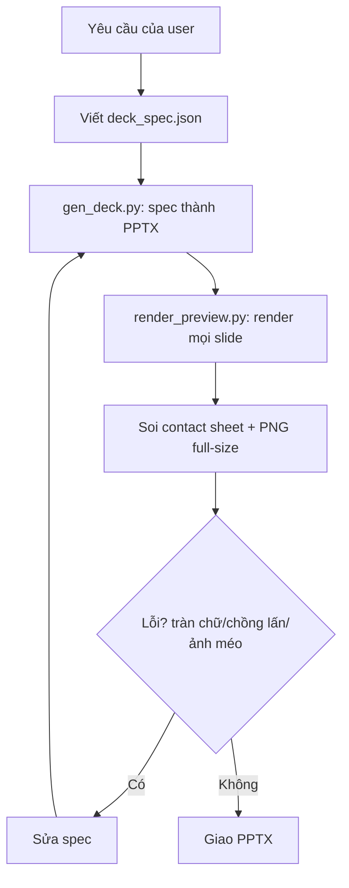
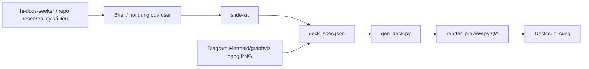

# Slide Kit Skill: Hướng dẫn đầy đủ

> `slide-kit` là deck generator dựa trên Python: biến một JSON spec thành file `.pptx` theo style Modernization (Template3) cố định, rồi render từng slide để QA trực quan bắt buộc trước khi giao.

## 1. Mục tiêu

Skill tạo deck `.pptx` đúng theo style được trích xuất từ `Template3.pptx` (deck "Modernization Strategy"):

- slide cover/section/closing nền navy với artwork constellation thật (1920×1080) và tiêu đề Lato Bold trắng 50pt;
- slide nội dung nền trắng: eyebrow 12pt + tiêu đề Lato 32pt slate `#445469` + 3 ô vuông accent + số trang góc phải-dưới;
- infobox nền xanh nhạt `#C9EAF7`, flowchart box bo tròn slate/lime có mũi tên, timeline ngang;
- bảng zebra header xanh dương `#1986AF`, panel code slate đậm, ghi chú đỏ đậm nghiêng cuối trang.

Kit **brand-neutral** tuyệt đối: slide không có logo, không thương hiệu công ty nào.

Dùng khi user yêu cầu tạo slides/deck/pptx "theo style này", "giống Template3/Modernization", hoặc load kit một cách rõ ràng.

## 2. Hard outcomes

- Deck bám đúng style tokens cố định (đã hardcode trong `gen_deck.py`, không suy lại mỗi lần chạy).
- Mọi slide được render bằng PowerPoint thật và soi trực quan trước khi tuyên bố hoàn thành.
- Mật độ chữ hợp lý: tối đa ~6 bullet/slide, bảng ≤ 12 dòng, một slide một ý.
- Ngôn ngữ slide theo ngôn ngữ user (deck gốc tiếng Việt có dấu — Lato hiển thị tốt).

## 3. Workflow tổng quát



## 4. Quick start

```bash
python3 <skill_dir>/scripts/gen_deck.py spec.json -o deck.pptx
python3 <skill_dir>/scripts/gen_deck.py <skill_dir>/examples/deck_spec.json -o /tmp/example_deck.pptx
```

QA bắt buộc trước khi giao:

```bash
python3 <skill_dir>/scripts/render_preview.py deck.pptx --output-dir /tmp/deck_preview
```

Mở `contact-sheet.jpg` và từng `slide-NN.png`, kiểm tra: text tràn khung/chồng lấn, bảng quá dài, node/connector lệch, nhãn timeline xuống dòng, ảnh méo. Sửa spec → gen lại → render lại đến khi sạch. Không tuyên bố hoàn thành trước khi render và kiểm tra từng slide.

## 5. Spec format (JSON)

Cấp top:

```jsonc
{
  "output": "deck.pptx",
  "eyebrow": "Modernization Strategy",
  "slides": [
    { "layout": "cover",   "title": "...", "subtitle": "...(tùy chọn)", "title_y": 182.9, "size": 50 },
    { "layout": "section", "title": "..." },
    { "layout": "content", "title": "...", "body": [ /* blocks */ ],
      "note": "ghi chú chân slide", "note_size": 14, "note_color": "FF0000" },
    { "layout": "thanks",  "title": "THANK YOU!" }
  ]
}
```

- Bốn layout: `cover`, `section` (trang chia mục, giống cover, không số trang), `content`, `thanks`. Layout `agenda` cũ đã bỏ (template không có).
- `eyebrow` cấp root áp dụng cho mọi slide nội dung, có thể ghi đè theo slide.
- `note` là ghi chú đỏ `#FF0000` đậm nghiêng ở chân slide (mặc định 14pt).
- Mỗi slide nhận thêm `"notes": "speaker notes"`.

### Body blocks

Body là mảng block xếp dọc trong vùng 46.7→919pt / y 88→500pt; `"h"` đặt chiều cao block theo pt (bỏ qua thì tự đo):

| type | tham số chính |
|---|---|
| `bullets` | `items`: [{"t", "lvl" 0/1/2, "bold"}] — 18/16/14pt, bullet `•`, marL 22.5/58.5/94.5pt |
| `heading` | `text`, `size` (18 mặc định) |
| `infobox` | `cols`: [[{"title", "text"} hoặc {"paras": [...]}], [...]] — hộp `#C9EAF7` 12pt; `row_gap` 23.3, `col_gap` 51.5 |
| `flow` | `nodes`: [{"id", "x", "y", "w" 114, "h" 61.7, "tone" "slate"/"lime"/"outline", "text", "sub", "size" 16}], `edges`: [{"from", "to", "type" "elbow"/"straight", "from_side"/"to_side", "points", "dash", "arrow"}] |
| `timeline` | `stages`: [...] — đường x=91→858, chấm `#45546B`, nhãn đậm 18pt; `y`, `x0`, `x1`, `label_size` |
| `table` | `header` [], `rows` [[...]], `cols` [tỉ lệ], `align`, `size` (tự chọn 11→8), ô `"^"` = trộn dọc |
| `image` | `path`, fit-giữa khung; `caption` 14pt nghiêng; `callouts`: [{"text", "xy", "point"}] — nhãn + đường đứt cam chỉ vào ảnh |
| `columns` | `cols`: [block...], `weights`, `gap` |
| `code` | `panels`: [{`title`, `code`}], nền slate `#46546C`, `size` 8, highlight JSON/SQL-ish |
| `cards` | `groups` + `legend` — chip tint lime/blue/peach theo palette theme |

### Inline markup (dùng trong mọi text)

- `**in đậm**`
- `[[red|chữ đỏ]]` — màu: `red` `#D53E23`, `green` `#21B14B`, `orange` `#FB8635`, `teal` `#1986AF`, `tealdark` `#0E5F7E`, `blue` `#0066B3`, `gray` `#7F7F7F`, `white`, `ink` `#445469`, `lime` `#9CB631`, `slate` `#46546C`

## 6. Style tokens

Token hardcode trong `gen_deck.py`, đo trực tiếp từ Template3.pptx; các giá trị chính:

| Token | Giá trị | Dùng cho |
|---|---|---|
| Kích thước trang | 13.33 × 7.5 in (960×540pt), 16:9 | |
| Font chữ | Lato Regular (số trang "Lato"), dự phòng Arial | |
| Màu chữ | `#445469` (theme dk1/dk2) | eyebrow, title, body |
| Nền cover/section/thanks | `assets/bg_cover.jpg` / `bg_thanks.jpg` (1920×1080, navy constellation) | |
| Cover title | Lato Bold 50pt trắng, box (32.3, 182.9) 626.6×117.9pt; subtitle 14pt trắng (33.6, 311.7) | |
| Eyebrow / Title | 12pt (30.7, 11.8) / 32pt (30.7, 25.8) 872.3×33.5pt, spacing 90% | slide nội dung |
| 3 ô vuông | 8.6×7.2pt tại (33.8/48.3/62.8, 63.3), `#0066B3`/`#F36F21`/`#22B24C` | slide nội dung |
| Số trang | 10pt `#7F7F7F` (931.6, 508.9) + vạch `#A6A6A6`, đánh số tuyệt đối, chỉ slide content | |
| Note | 14pt đậm nghiêng `#FF0000`, box (8.9, 460) anchor đáy | |
| Infobox / Bảng | `#C9EAF7` / header `#1986AF` + zebra `#C9EAF7`/`#EAF6FC` | |
| Flow / Timeline | slate `#46546C`, lime `#9CB631`, line 2.2pt / line `#8A93A0`, dot `#45546B` | |
| Callout | đứt cam `#FB8635` 1.5pt, nhãn 18pt | |
| Code panel | nền `#46546C`, key `#E06C75`, string `#98C379`, comment `#97A3B3`, số `#D19A66` | |
| Kích thước flow box | 114×61.7pt bo 16.7% | |

## 7. Quy tắc soạn nội dung

- `eyebrow` đặt 1 lần ở root (vd. "Modernization Strategy" trong template).
- Tiêu đề slide nội dung là cụm ngắn (không bắt buộc đánh số).
- Mật độ: tối đa ~6 bullet/slide hoặc bảng ≤ 12 dòng; một slide một ý. Nội dung dày thì tách slide.
- Ưu tiên infobox/bảng + markup in đậm/màu thay vì đoạn văn dài; điểm cần chú ý dùng `note` đỏ cuối trang.
- Diagram: dùng block `flow`/`timeline` cho đúng style, hoặc sinh ảnh PNG (≥2x) rồi nhúng qua `image`/`columns`; screenshot có thể kèm `callouts` đứt cam.
- Tọa độ `flow`/`callouts` đo theo hệ pt 960×540.

## 8. Files và môi trường

```
slide-kit/
├── SKILL.md                  ← nguồn chân lý của guide này
├── assets/                   ← bg_cover.jpg, bg_thanks.jpg (ảnh nền template)
├── scripts/gen_deck.py       ← spec JSON → .pptx (python-pptx)
├── scripts/render_preview.py ← .pptx → PNG từng slide + contact sheet (PowerPoint AppleScript, fallback soffice)
└── examples/deck_spec.json   ← deck mẫu đủ mọi layout/block (kèm example_diagram.png)
```

Yêu cầu môi trường: Python 3 + `python-pptx`, `pillow`; macOS + Microsoft PowerPoint để render QA (hoặc LibreOffice). Máy cần font **Lato** để ra đúng chữ.

## 9. Mở rộng

- Layout/block mới → thêm renderer vào `BLOCK_RENDERERS` trong `gen_deck.py`, dùng đúng token màu ở trên; đo vị trí theo pt trên hệ 960×540.
- Đổi artwork nền → thay file trong `assets/` giữ nguyên tên và tỉ lệ 1920×1080.

## 10. Verify slide-kit

- [ ] Spec hợp lệ: cả bốn layout dùng đúng, block well-formed.
- [ ] `gen_deck.py` chạy sạch (không warning overflow).
- [ ] `render_preview.py` đã render mọi slide.
- [ ] Contact sheet + từng slide full-size đã soi.
- [ ] Không tràn chữ/chồng lấn; bảng vừa khung; node/connector thẳng hàng; ảnh không méo.
- [ ] Slide nội dung đủ chrome: eyebrow, 3 ô vuông, số trang.
- [ ] Mật độ đúng giới hạn (~6 bullet hoặc bảng ≤ 12 dòng mỗi slide).
- [ ] Mọi lần sửa đều đi kèm gen lại + render lại toàn bộ.

## 11. Quan hệ với skill khác



## 12. Giới hạn

- Visual system cố định: một style Template3 duy nhất; không sinh chart từ data file như một BI pipeline đầy đủ (chart ở đây là bảng/cards/ảnh).
- Render QA cần macOS + PowerPoint (hoặc LibreOffice); môi trường khác thì đường preview bị suy giảm.
- Style token hardcode — muốn đổi style phải sửa `gen_deck.py`, không có file config.
- Diagram phức tạp ngoài `flow`/`timeline` phải tự sinh ở ngoài (Mermaid/graphviz/draw.io) rồi nhúng vào dạng PNG.

## 13. Tóm tắt

> `slide-kit` đổi sự linh hoạt thiết kế lấy tính nhất quán: viết JSON spec, sinh `.pptx` theo style Template3 cố định, render và soi từng slide, rồi mới giao.
